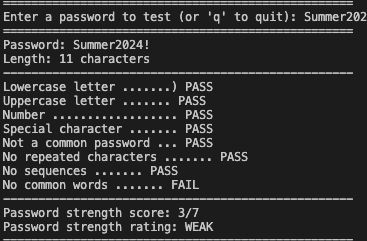
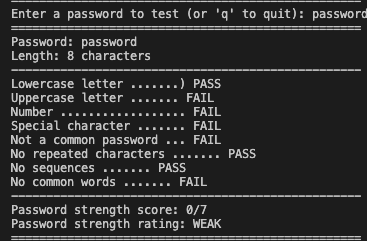
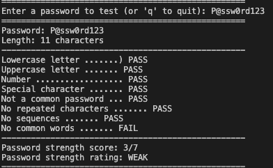
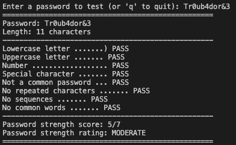
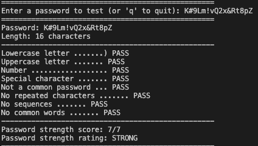
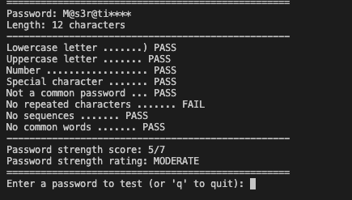

# Password Strength Tester

The first thing standing between an attacker and most accounts is a password, and it's usually the weakest part of the whole setup. When people make passwords, they typically choose something rememberable like a word, a name, or a year, and then maybe sprinkle in a capital letter or symbol to satisfy the site's rules. Attackers feast on this way of thinking, and their tools are built around it.

So I built a Password Strength Tester in Python. It gets a password, checks it against set factors, grades it out of 7, and classifies it as **Weak**, **Moderate**, or **Strong**.

Built for a cybersecurity course at Southern University and A&M College.



## The question

How much does password complexity actually affect security? Initially I expected that following the usual rules would make a password strong. What I ended up finding is that a password can check every complexity box and still be easy to crack.

## How it works

The program is a Python 3.12 console application. No outside libraries, just Python. I built it in stages and tested each stage as I moved on, so every check has its own function. That made debugging much easier, and it gives me the option to add a GUI later without touching the logic.

- **check_length** gives points for length. Under 8 characters scores 0, 8 to 11 scores 1, 12 to 15 scores 2, and 16 or more scores 3. Length gets the most points because every extra character multiplies the number of guesses a brute force attack needs.
- **check_characters** seeks a lowercase letter, an uppercase letter, a number, and a special character. Each one found is worth 1 point.
- **load_common_passwords** reads a list of commonly used and leaked passwords from a text file into a set, so lookups are quick.
- **check_common** checks if the whole password is on the common list, and checks if a common word is hidden inside, like "summer" inside `Summer2024!`.
- **undo_leet** reverses leetspeak swaps, so `@` becomes `a`, `0` becomes `o`, `$` becomes `s`, etc. This is so `P@ssw0rd` gets read as "password" before the common word check runs.
- **has_sequences** looks for runs like `1234`, `abcd`, or `qwer`, forward and backward.
- **has_repeats** looks for the same character 3 or more times in a row, like `aaa` or `333`.
- **calculating_rating** adds everything up, applies penalties, and creates the final rating.

## Scoring

| Check | Points |
|---|---|
| Length (8–11 / 12–15 / 16+) | +1 / +2 / +3 |
| Lowercase letter | +1 |
| Uppercase letter | +1 |
| Number | +1 |
| Special character | +1 |
| Contains a sequence | −1 |
| Contains repeated characters | −1 |
| Built on a common word | −2 |

The max score is 7. A score of 0 to 3 is Weak, 4 to 5 is Moderate, and 6 to 7 is Strong. Two rules override the score: any password that's on the common list or shorter than 8 characters is automatically Weak. The common word gets the biggest penalty because dictionary attacks try known words first, so that's the first weakness attackers go after.

## How to run it

```bash
git clone https://github.com/blkmonday/password-strength-tester.git
cd password-strength-tester
python3 password_tester.py
```

Type a password to test it, or `q` to quit.

## Results

I tested six passwords picked to cover every rating and every type of weakness, including one made up on the spot to show the program running live. None of these are passwords I actually use.

| Password | Length | Score | Rating | Deduction |
|---|---|---|---|---|
| `password` | 8 | 0/7 | Weak | On the common password list |
| `Summer2024!` | 11 | 3/7 | Weak | Common word plus a year |
| `P@ssw0rd123` | 11 | 3/7 | Weak | Leetspeak version of "password" |
| `Tr0ub4dor&3` | 11 | 5/7 | Moderate | Good variety, but only 11 characters |
| `M@s3r@ti****` | 12 | 5/7 | Moderate | Four repeated asterisks |
| `K#9Lm!vQ2x&Rt8pZ` | 16 | 7/7 | Strong | None, passes every check |

<details>
<summary>Screenshots</summary>








</details>

## What I found

Following complexity rules does not make a password automatically strong. `Summer2024!` and `P@ssw0rd123` both have an uppercase letter, a lowercase letter, a number, and a special character. A bunch of real websites would give them a strong rating, but my program rated them Weak, which I feel is the right call.

You have to think like an attacker. They don't start by just guessing random characters. They run dictionary attacks using lists of words and leaked passwords, with cracking tools like Hashcat that automatically try common tricks on top of those words: capitalizing the first letter, adding a year, putting `!` at the end, or swapping letters for symbols. `Summer2024!` is essentially a word, a year, and a symbol, so it's one of the first things those tools would try.

The only Strong result was `K#9Lm!vQ2x&Rt8pZ`, 16 random characters with no words, no sequences, and no repeats. That leaves a dictionary attack weaponless, so brute force is the only option left, and 16 characters make that impractical.

Altogether, length and unpredictability matter much more than having different characters.

## Limitations

- The common password list only has about 30 entries. Real tools use lists with millions of leaked passwords.
- It can only catch patterns I programmed it to look for. A password built on a name or word that isn't in my list could slip through.
- The scoring is my own system, so it estimates strength rather than how long a password would actually take to crack.

## What's next

- A GUI
- A way bigger password list
- A check against the HaveIBeenPwned database to see if a password has shown up in a real data breach

## Project structure

```
password-strength-tester/
├── password_tester.py      # the program
├── common_passwords.txt    # list of common and leaked passwords
├── screenshots/            # test output
└── README.md
```
